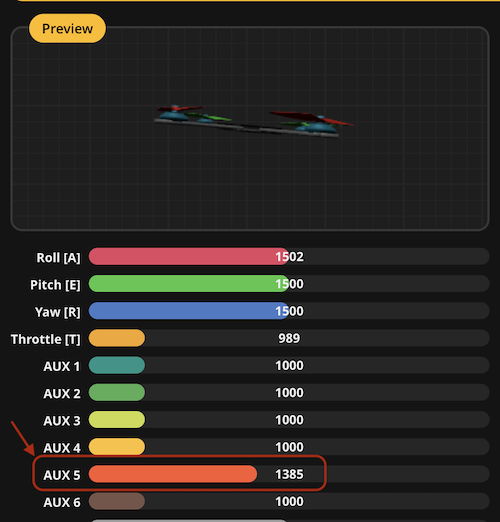
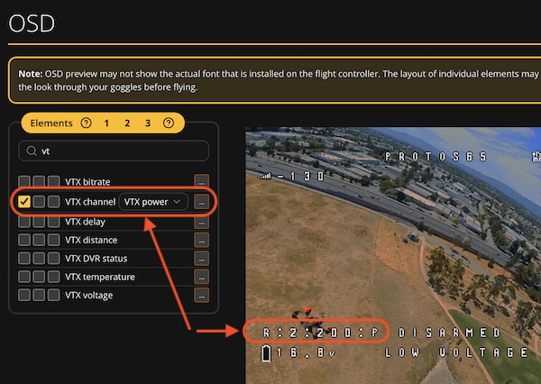

# FPV Notes and Configurations

Collection of various important notes and configurations related to FPV (First Person View) drone
flying. Personal reference use only. Use at your own risk!

# Important Details
 * Core temp must be BELOW  70C

# Setup Notes
This is for brand new setup. Some useful references:

 * https://www.youtube.com/watch?v=r8WMn2OeP4Q
 * https://oscarliang.com/setup-radiomaster-pocket/

## General Setup Steps:

 1. Setup radio transmitter - esp the buttons assingments
 2. Setup drone profile in Betaflight
 3. Bind the radio to the drone to the controller
 4. Bind the drone to the FPV goggles

 Additional notes below.

## RadioMaster Pocket

You must ensure you setup these basics up correctly!

 1. Setup a new **Model**
 2. **Setup** page - set the Internal RF to CSRF
 3. **Mixed** page - set throttle, yaw, pitch, and roll AND buttons like SB, SA, 
    SD, etc. for arming, flight modes, etc in Betaflight. Refer to the drone's manual for
    the buttons. RadioMaster Pocket reference manual `docs/RadioMaster-Pocket_A1.8.pdf`.
 4. **Special Functions** - Set SA or arm button to play track called `armed`

## Bind Drone with Controller

 1. Put the drone into bind mode - usually connect/disconnect the battery 3 times quickly.
 2. Bind using the SYS -> ExpressLRS -> BIND
 3. If you get stuck in "Loading..." after choosing ExpressLRS, set Internal RF to CRSF in the
    **Setup** page and try again.
 4. Once bound, you can test by restarting the drone. It should say "Telemetry lost" and then
    "Telemetry restored" when you power on the controller.

## Bind FPV with Goggle

 1. Use the Auto Search function

## Betaflight Configuration

 1. Connect using the web Betaflight app
 2. BACKUP your presets first!
 3. **Modes** - check your mode settings
 
## Bind VTX Power with RadioMaster Pocket SF Dial

Using Betaflight CLI, you can set specific VTX power level to SF pot dial on the RadioMaster Pocket.

### RadioMaster Pocket Setup

First, ensure you have your `SF` dial button set up correctly in the **Mixed** page. You can use the
following steps:

 1. Go to your Model, then go to page 6 "Mixed"
 2. **Mixed** page - add a new channel 
    * Source: SF

Then check in Betaflight "Receiver" tab that the SF dial is working correctly. You should see the
aux channel value change as you turn the dial:




You should also set your OSD to display VTX power:




### Betaflight CLI Setup

You can check your VTX table in Betaflight CLI:
```
vtxtable
```
Output will look like:
```
# vtxtable
vtxtable bands 6
vtxtable channels 8
vtxtable band 1 BOSCAM_A A FACTORY 5865 5845 5825 5805 5785 5765 5745 5725
vtxtable band 2 BOSCAM_B B FACTORY 5733 5752 5771 5790 5809 5828 5847 5866
vtxtable band 3 BOSCAM_E E FACTORY 5705 5685 5665 5645 5885 5905 5925 5945
vtxtable band 4 FATSHARK F FACTORY 5740 5760 5780 5800 5820 5840 5860 5880
vtxtable band 5 RACEBAND R FACTORY 5658 5695 5732 5769 5806 5843 5880 5917
vtxtable band 6 LOWRACE  L FACTORY 5362 5399 5436 5473 5510 5547 5584 5621
vtxtable powerlevels 5
vtxtable powervalues 1 2 3 4 0
vtxtable powerlabels 25 100 200 400 PIT
```

To program VTX Power using the dial you can bind the vtx channel, band and power to a specific range
of aux channel values (the RadioMaster Pocket's dial button) using the `vtx` command.

The format is:
```
vtx <index> <aux_channel> <vtx_band> <vtx_channel> <vtx_power> <start_range> <end_range>
```

Reference:
 * `index` - 0 to 3 for the 4 possible ranges you can set
 * `aux_channel` - RadioMaster aux input channel value BUT **minus 1**. For example, if you are using aux channel 5, you would use 4
 * `vtx_band` - 1 to 6 for the bands listed in the `vtxtable` output above. For example, if you want to use the `RACEBAND`, you would use 5
 * `vtx_channel` - 1 to 8 for the channels that you've configured in Betaflight under Video Transmitter (VTX) settings
 * `vtx_power` - 0 to 4 for the power levels listed in the `vtxtable` output above. For example, if you want to use 400mW, you would use 3

Example below - enter each line one at a time:
```
vtx 0 4 5 0 1 1000 1250
vtx 1 4 5 0 2 1251 1500
vtx 2 4 5 0 3 1501 1750
vtx 3 4 5 0 4 1751 2000
```

Lastly, don't forget to save your settings in Betaflight CLI:
```
save
```
